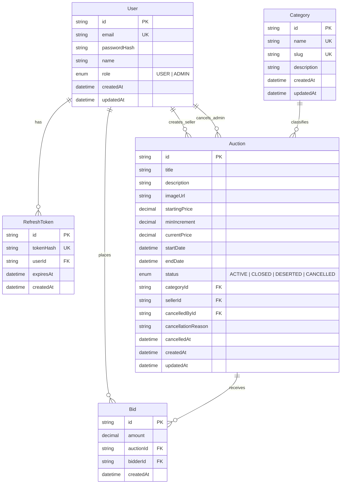

# BidHub — Reglas de Negocio, Modelo de Base de Datos y Backend

Este documento detalla todas las reglas de negocio de la plataforma **BidHub**, el diseño relacional para **PostgreSQL (Supabase)**, y el esquema propuesto para **Prisma ORM**, garantizando que la lógica crítica quede blindada en el backend.

---

## 1. Reglas de Negocio

### 1.1. Roles y Permisos
- **USER:**
  - Registrarse e iniciar sesión.
  - Explorar catálogo y ver detalle de subastas.
  - Publicar hasta **5 subastas activas** simultáneamente como vendedor.
  - Ofertar en subastas de otros usuarios.
  - Editar su subasta **únicamente si no tiene ofertas** y sigue activa.
  - Cancelar su subasta **únicamente si no tiene ofertas**.
  - Ver su propio dashboard con sus subastas creadas y sus ofertas realizadas.
- **ADMIN:**
  - Creado exclusivamente vía **seed** (no por registro público).
  - Gestionar categorías (crear, editar, eliminar si no tiene subastas).
  - Moderar/cancelar cualquier subasta activa (con o sin ofertas), registrando un **motivo obligatorio**.
  - No puede eliminarse el historial de subastas ni ofertas canceladas.

---

### 1.2. Publicación de Subastas
1. **Precio inicial:** Obligatorio y estrictamente mayor a 0 (`startingPrice > 0`).
2. **Incremento mínimo:** Obligatorio y estrictamente mayor a 0 (`minIncrement > 0`).
3. **Ventana de fecha de cierre:**
   - La fecha de cierre (`endDate`) debe estar entre **1 hora** y **7 días** a partir de la fecha de creación.
   ```ts
   now + 1 hour <= endDate <= now + 7 days
   ```
4. **Categoría:** Toda subasta debe pertenecer a una categoría existente en el sistema.
5. **Límite de vendedor:** Un usuario no puede tener más de **5 subastas activas** al mismo tiempo.
6. **Edición:** El vendedor solo puede modificar su subasta si **no tiene ofertas** registradas y la subasta está activa. Si ya tiene al menos una oferta, queda bloqueada.

---

### 1.3. Sistema de Ofertas (Bids)
1. **No auto-puja:** Un usuario **no puede ofertar en su propia subasta**.
2. **Subasta activa:** Solo se puede ofertar si la subasta no está cancelada y su fecha de cierre no ha vencido (`now < endDate`).
3. **Monto de la oferta:**
   - **Primera oferta:** Debe ser `>= startingPrice`.
   - **Ofertas siguientes:** Debe ser `>= currentPrice + minIncrement` (donde `currentPrice` es el monto de la oferta más alta actual).
4. **No auto-superación inmediata:** El usuario que actualmente tiene la oferta más alta **no puede volver a ofertar** hasta que otro usuario lo supere.
5. **Inmutabilidad:** Las ofertas son de solo inserción (nunca se editan ni se eliminan).
6. **Regla Anti-Sniping (Extensión de tiempo):**
   - Si entra una oferta válida cuando faltan **5 minutos o menos** para el cierre, la fecha de cierre (`endDate`) se extiende **5 minutos adicionales** desde su valor actual.
   - Esta regla se repite cuantas veces sea necesario mientras sigan entrando ofertas en ese margen.

---

### 1.4. Estados y Cierre Dinámico de Subastas
Una subasta posee cuatro estados posibles:
- `ACTIVE`: Fecha actual menor a `endDate` y no cancelada.
- `CLOSED`: Llegó la fecha de cierre (`now >= endDate`) y **tiene al menos una oferta**. El ganador es el postor con la oferta más alta.
- `DESERTED`: Llegó la fecha de cierre (`now >= endDate`) y **no recibió ninguna oferta**.
- `CANCELLED`: Cancelada por el vendedor (sin ofertas) o por un administrador (con motivo).

> **Principio de Estado Dinámico:** El estado no depende de cron jobs ni tareas en segundo plano. Al consultar cualquier subasta, el backend calcula o sincroniza su estado evaluando si `now >= endDate` en conjunto con el conteo de ofertas.

---

### 1.5. Cancelación y Moderación
1. **Por el Vendedor:** Puede cancelar únicamente si la subasta está activa y tiene **0 ofertas**.
2. **Por el Administrador:** Puede cancelar cualquier subasta activa, incluso si ya cuenta con ofertas. Es obligatorio registrar:
   - `cancellationReason`: Motivo detallado.
   - `cancelledById`: ID del administrador moderador.
   - `cancelledAt`: Marca de tiempo.
3. **Trazabilidad:** Una subasta cancelada o cerrada **nunca se borra físicamente** (`soft-delete` / retención histórica).

---

### 1.6. Categorías
- Cada subasta pertenece a una categoría.
- Una categoría **no se puede eliminar** si tiene al menos una subasta asociada (integridad referencial restringida).

---

### 1.7. Privacidad y Seguridad
1. **Privacidad de ofertas:** En la vista pública de ofertas, no se exponen nombre completo ni email. Se muestra un alias enmascarado (ej. `J***z` o `u***4`).
2. **Control de acceso:** Un usuario solo puede visualizar el detalle completo de sus propias ofertas en su dashboard privado.
3. **Seguridad de endpoints:** Validación estricta de propiedad (un usuario no puede cancelar ni editar subastas ajenas aunque modifique el ID en la URL).

---

### 1.8. Autenticación y Sesiones
1. **Contraseñas:** Hasheadas con `bcryptjs` o `argon2` (mínimo 10-12 salt rounds).
2. **Tokens en Cookies:**
   - `accessToken`: JWT de corta duración (15 min) en cookie `httpOnly`, `secure`, `sameSite: "lax"`.
   - `refreshToken`: Token de larga duración (7 días) en cookie `httpOnly`, `secure`, `sameSite: "lax"`.
3. **Revocación de Refresh Token:**
   - El refresh token se almacena **hasheado** en la tabla `RefreshToken` de la base de datos.
   - Al hacer logout o rotación, se elimina o invalida en la base de datos.

---

## 2. Modelo Relacional de Base de Datos



---

## 3. Esquema Propuesto de Prisma (`prisma/schema.prisma`)

```prisma
datasource db {
  provider  = "postgresql"
  url       = env("DATABASE_URL")
  directUrl = env("DIRECT_URL")
}

generator client {
  provider = "prisma-client-js"
}

enum Role {
  USER
  ADMIN
}

enum AuctionStatus {
  ACTIVE
  CLOSED
  DESERTED
  CANCELLED
}

model User {
  id            String         @id @default(uuid())
  email         String         @unique
  passwordHash  String
  name          String
  role          Role           @default(USER)
  createdAt     DateTime       @default(now())
  updatedAt     DateTime       @updatedAt

  // Relaciones
  auctions      Auction[]      @relation("SellerAuctions")
  cancelledAuctions Auction[]  @relation("AdminCancelledAuctions")
  bids          Bid[]
  refreshTokens RefreshToken[]

  @@map("users")
}

model RefreshToken {
  id        String   @id @default(uuid())
  tokenHash String   @unique
  userId    String
  user      User     @relation(fields: [userId], references: [id], onDelete: Cascade)
  expiresAt DateTime
  createdAt DateTime @default(now())

  @@index([userId])
  @@map("refresh_tokens")
}

model Category {
  id          String    @id @default(uuid())
  name        String    @unique
  slug        String    @unique
  description String?
  createdAt   DateTime  @default(now())
  updatedAt   DateTime  @updatedAt

  auctions    Auction[]

  @@map("categories")
}

model Auction {
  id                 String        @id @default(uuid())
  title              String
  description        String        @db.Text
  imageUrl           String?
  startingPrice      Decimal       @db.Decimal(12, 2)
  minIncrement       Decimal       @db.Decimal(12, 2)
  currentPrice       Decimal       @db.Decimal(12, 2)
  startDate          DateTime      @default(now())
  endDate            DateTime
  status             AuctionStatus @default(ACTIVE)

  // Categoría (ON DELETE RESTRICT para cumplir regla de no eliminar categorías con subastas)
  categoryId         String
  category           Category      @relation(fields: [categoryId], references: [id], onDelete: Restrict)

  // Vendedor
  sellerId           String
  seller             User          @relation("SellerAuctions", fields: [sellerId], references: [id], onDelete: Restrict)

  // Moderación / Cancelación
  cancelledById      String?
  cancelledBy        User?         @relation("AdminCancelledAuctions", fields: [cancelledById], references: [id], onDelete: SetNull)
  cancellationReason String?       @db.Text
  cancelledAt        DateTime?

  // Ofertas
  bids               Bid[]

  createdAt          DateTime      @default(now())
  updatedAt          DateTime      @updatedAt

  @@index([sellerId, status])
  @@index([categoryId, status])
  @@index([endDate, status])
  @@map("auctions")
}

model Bid {
  id        String   @id @default(uuid())
  amount    Decimal  @db.Decimal(12, 2)

  auctionId String
  auction   Auction  @relation(fields: [auctionId], references: [id], onDelete: Restrict)

  bidderId  String
  bidder    User     @relation(fields: [bidderId], references: [id], onDelete: Restrict)

  createdAt DateTime @default(now())

  @@index([auctionId, amount(sort: Desc)])
  @@index([bidderId])
  @@map("bids")
}
```

---

## 4. Estrategia de Backend para Reglas Críticas

### 4.1. Transacción Atómica de Ofertas (`prisma.$transaction`)
Para evitar condiciones de carrera cuando dos usuarios ofertan al mismo segundo:
1. Abrir transacción interactiva.
2. Leer la subasta con bloqueo o validación de versión.
3. Verificar que `now < auction.endDate` y `status === ACTIVE`.
4. Verificar que el usuario no sea el vendedor ni tenga la oferta más alta.
5. Verificar `amount >= auction.currentPrice + auction.minIncrement`.
6. Crear el registro en `Bid`.
7. Actualizar `currentPrice` en `Auction`.
8. Si faltan `<= 5 minutos`, extender `endDate = endDate + 5 minutes`.

### 4.2. Función Helper de Estado Dinámico
Al consultar cualquier subasta:
```ts
export function resolveAuctionStatus(auction: AuctionWithBids): AuctionStatus {
  if (auction.status === "CANCELLED") return "CANCELLED";
  if (new Date() >= new Date(auction.endDate)) {
    return auction.bids.length > 0 ? "CLOSED" : "DESERTED";
  }
  return "ACTIVE";
}
```

---

## 5. Próximos Pasos de Implementación
1. **Instalar dependencias de Prisma:**
   `npm install @prisma/client` y `npm install -D prisma`
2. **Inicializar Prisma:**
   `npx prisma init`
3. **Configurar variables en `.env`:**
   Cadena de conexión de Supabase (`DATABASE_URL` y `DIRECT_URL`).
4. **Ejecutar migración inicial:**
   `npx prisma migrate dev --name init_bidhub`
5. **Crear script de Seed:**
   Admin inicial, categorías base y subastas demo en los 4 estados.
